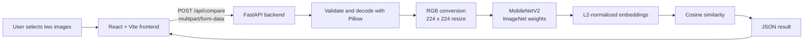

# SYNAPSE — AI Image Similarity Analyzer

> **Where Images Connect. Intelligence Reveals.**

SYNAPSE is a full-stack computer-vision application that compares two uploaded images using deep visual features rather than pixel equality. It converts each image into a MobileNetV2 embedding, compares the embeddings with cosine similarity, and presents the raw score, a display index, classification, and image metadata in a responsive web interface.

The project is intended for educational exploration, visual asset comparison, image retrieval experiments, and other workflows where semantic visual similarity is useful. Its similarity classifications are transparent heuristics, not a calibrated identity or probability system.

## Table of Contents

- [Key Features](#key-features)
- [Live Demo](#live-demo)
- [Screenshots](#screenshots)
- [Technology Stack](#technology-stack)
- [System Architecture](#system-architecture)
- [How It Works](#how-it-works)
- [Project Structure](#project-structure)
- [Installation and Local Setup](#installation-and-local-setup)
- [Environment Variables](#environment-variables)
- [API Documentation](#api-documentation)
- [Machine Learning Approach](#machine-learning-approach)
- [Testing](#testing)
- [Deployment](#deployment)
- [Limitations and Future Improvements](#limitations-and-future-improvements)
- [Contributing](#contributing)
- [License](#license)
- [Acknowledgements](#acknowledgements)

## Key Features

- Upload two JPG, JPEG, PNG, or WEBP images through a drag-and-drop or file-picker interface.
- Validate file type, MIME type, file size, readability, and minimum dimensions in the browser and backend.
- Extract deep visual features with MobileNetV2 using ImageNet weights.
- Calculate raw cosine similarity between L2-normalized image embeddings.
- Visualize the result with a score ring, raw cosine value, normalized display index, classification, and metadata.
- Return explicit API errors for invalid uploads, unavailable model state, and unexpected processing failures.
- Use a responsive React interface with loading, error, reset, and result states.

## Live Demo

- **Frontend:** [synapse-fs95.vercel.app](https://synapse-fs95.vercel.app)
- **Backend API:** [synapse-1-c6xv.onrender.com](https://synapse-1-c6xv.onrender.com)
- **Interactive API documentation:** [OpenAPI / Swagger UI](https://synapse-1-c6xv.onrender.com/docs)

## Screenshots

Screenshots are not currently included in the repository.

> **Screenshot placeholder:** Add a screenshot of the upload workspace here.
>
> **Screenshot placeholder:** Add a screenshot of the comparison result here.

## Technology Stack

| Area | Technologies |
| --- | --- |
| Frontend | React 18, React DOM, Vite, Framer Motion, Lucide React |
| Backend | Python 3.11, FastAPI, Uvicorn, Pydantic, `python-multipart` |
| Machine learning | TensorFlow 2.18, MobileNetV2 with ImageNet weights, NumPy |
| Image processing | Pillow |
| Development and testing | npm, Vite, Vitest, pytest |

## System Architecture

The React frontend sends the two selected files as a `multipart/form-data` request to the FastAPI backend. The backend processes both files in memory, extracts embeddings with a model initialized during application startup, computes similarity, and returns a structured JSON response.



The backend exposes a health endpoint alongside the comparison endpoint. Uploaded bytes are processed in memory and are not persisted by the application.

## How It Works

1. The user selects two supported images in the frontend.
2. The browser checks the MIME type, 10 MB size limit, and minimum 32×32 dimensions.
3. The frontend submits `image1` and `image2` as multipart form fields.
4. The backend validates the extension, MIME type, file size, image readability, and dimensions.
5. Pillow converts each image to RGB and resizes it to 224×224 pixels.
6. TensorFlow applies MobileNetV2 preprocessing and generates a feature vector using the network without its classification head and with global average pooling.
7. Each vector is L2-normalized, then the backend computes cosine similarity.
8. The API returns the raw cosine score, a normalized display index, a provisional classification, metadata, and explanatory text.
9. The frontend renders the result and the uploaded image previews.

Cosine similarity measures the angle between two vectors. A value closer to `1` indicates that the feature directions are more alike, while a value closer to `-1` indicates opposing directions. The implementation clips the raw result to `[-1, 1]`.

The displayed `normalized_similarity_index` is calculated as:

```text
((cosine_similarity + 1) / 2) * 100
```

It is a transformed display score, not a probability, calibrated semantic percentage, pixel-equality measure, or guarantee that a given percentage of image content is identical.

## Project Structure

```text
.
├── .env.example
├── .gitignore
├── README.md
├── backend
│   ├── app
│   │   ├── __init__.py
│   │   ├── config.py
│   │   ├── feature_extractor.py
│   │   ├── image_processor.py
│   │   ├── main.py
│   │   ├── schemas.py
│   │   └── similarity.py
│   ├── requirements.txt
│   └── tests
│       ├── conftest.py
│       ├── test_image_cases.py
│       └── test_similarity.py
├── docs
│   ├── API_DOCUMENTATION.md
│   ├── ARCHITECTURE.md
│   ├── FINAL_TEST_REPORT.md
│   └── MACHINE_LEARNING.md
└── frontend
    ├── index.html
    ├── package.json
    ├── package-lock.json
    ├── vite.config.js
    └── src
        ├── main.jsx
        └── styles.css
```

### Important files

- [`backend/app/main.py`](backend/app/main.py) — FastAPI application, lifecycle-managed model initialization, CORS configuration, and API routes.
- [`backend/app/image_processor.py`](backend/app/image_processor.py) — upload validation, Pillow decoding, RGB conversion, resizing, and metadata.
- [`backend/app/feature_extractor.py`](backend/app/feature_extractor.py) — MobileNetV2 loading, preprocessing, embedding extraction, and L2 normalization.
- [`backend/app/similarity.py`](backend/app/similarity.py) — cosine similarity, normalized display index, and provisional classification bands.
- [`backend/app/schemas.py`](backend/app/schemas.py) — Pydantic response models.
- [`frontend/src/main.jsx`](frontend/src/main.jsx) — upload workflow, API request, result rendering, and UI state.
- [`frontend/src/styles.css`](frontend/src/styles.css) — responsive frontend styling.
- [`docs/`](docs/) — supporting API, architecture, ML, and validation documentation.

## Installation and Local Setup

### Prerequisites

- Python 3.11
- Node.js and npm
- A Windows PowerShell terminal for the commands below

### Clone the repository

```powershell
git clone https://github.com/aarishsamadder-06/Synapse.git
cd Synapse
```

### Set up the backend

Create and activate a Python 3.11 virtual environment:

```powershell
cd backend
python -m venv .venv
.\.venv\Scripts\Activate.ps1
```

Install the pinned backend dependencies:

```powershell
python -m pip install -r requirements.txt
```

Start the FastAPI development server:

```powershell
uvicorn app.main:app --reload
```

The backend is available at `http://localhost:8000`; Swagger UI is available at `http://localhost:8000/docs`.

The first model initialization may download MobileNetV2 ImageNet weights.

### Set up the frontend

In a second terminal, from the repository root:

```powershell
cd frontend
npm install
npm run dev
```

Open [http://localhost:5173](http://localhost:5173). By default, the frontend sends requests to `http://localhost:8000`.

## Environment Variables

The repository includes [`.env.example`](.env.example):

```dotenv
VITE_API_URL=http://localhost:8000
```

`VITE_API_URL` is read by the Vite frontend at build time and controls the backend base URL. For a deployed frontend, set it to the deployed backend URL.

The backend also reads these optional process environment variables directly:

| Variable | Default | Purpose |
| --- | --- | --- |
| `MAX_UPLOAD_SIZE` | `10485760` | Maximum upload size in bytes |
| `MIN_IMAGE_DIMENSION` | `32` | Minimum width and height in pixels |
| `FRONTEND_ORIGINS` | `http://localhost:5173,http://127.0.0.1:5173` in `config.py` | Origin configuration exposed by the backend configuration module |

The current CORS middleware in [`backend/app/main.py`](backend/app/main.py) explicitly allows `http://localhost:5173` and `https://synapse-fs95.vercel.app`. Do not commit secrets or local `.env` files.

## API Documentation

The deployed API provides interactive documentation at [`/docs`](https://synapse-1-c6xv.onrender.com/docs).

### `GET /api/health`

Returns model and service readiness:

```json
{
  "status": "ok",
  "model_ready": true,
  "model_name": "MobileNetV2",
  "api_version": "1.0.0"
}
```

If TensorFlow model initialization fails, the endpoint reports `"status": "degraded"` and `"model_ready": false`.

### `POST /api/compare`

Send a `multipart/form-data` request with two required file fields:

- `image1` — first JPG, JPEG, PNG, or WEBP image
- `image2` — second JPG, JPEG, PNG, or WEBP image

Example with `curl`:

```powershell
curl.exe -X POST http://localhost:8000/api/compare `
  -F "image1=@C:\path\to\image-a.png" `
  -F "image2=@C:\path\to\image-b.jpg"
```

Successful responses contain the following fields:

| Field | Type | Description |
| --- | --- | --- |
| `success` | boolean | Indicates a successful comparison. |
| `normalized_similarity_index` | number | Display-only transformation of the raw cosine, rounded to two decimals. |
| `cosine_similarity` | number | Raw cosine similarity, rounded to six decimals. |
| `classification` | string | Provisional raw-cosine band label. |
| `model_name` | string | Currently `MobileNetV2`. |
| `algorithm_name` | string | Currently `Cosine Similarity`. |
| `image1`, `image2` | object | Per-image metadata: `filename`, `width`, `height`, `format`, and `file_size`. |
| `explanation` | string | Explanation of the feature-extraction and comparison result. |
| `score_interpretation` | string | Limitation note about the provisional classification thresholds. |

### Error responses

| Status | Meaning |
| ---: | --- |
| `400` | Invalid, unsupported, unreadable, oversized, or undersized image |
| `503` | The model is not ready |
| `500` | Unexpected image-analysis failure |

## Machine Learning Approach

1. **Decode and validate:** Pillow verifies the upload, converts it to RGB, and checks the configured size and dimension limits.
2. **Resize:** Each image is resized to `224×224`, the input size used by the configured MobileNetV2 model.
3. **Preprocess:** TensorFlow's `mobilenet_v2.preprocess_input` prepares the batch for inference.
4. **Extract features:** MobileNetV2 uses `weights="imagenet"`, `include_top=False`, and `pooling="avg"` to produce a compact feature representation instead of a class prediction.
5. **Normalize:** The resulting vector is L2-normalized and checked for finite, non-zero values.
6. **Compare:** Cosine similarity compares the two normalized embeddings.

The current classification bands are provisional raw-cosine heuristics:

| Raw cosine | Classification |
| ---: | --- |
| `< 0.3` | Low Similarity |
| `0.3` to `< 0.6` | Moderate Similarity |
| `0.6` to `< 0.8` | High Similarity |
| `>= 0.8` | Very High Similarity |

MobileNetV2 was trained on ImageNet, so its features may not represent every domain equally well. The project does not currently provide a representative labelled validation set, threshold calibration, domain-specific fine-tuning, or a guarantee of semantic identity. Similarity scores should therefore be interpreted as model-derived signals rather than definitive judgments.

## Testing

### Backend tests

From the repository root:

```powershell
cd backend
python -m pytest -q
```

The verified result in the current repository is **5 passed, 5 skipped**. The five skipped tests are real MobileNetV2 image cases guarded by `SYNAPSE_RUN_MODEL_TESTS`.

To run those model-backed tests explicitly:

```powershell
cd C:\path\to\Synapse
.\backend\.venv\Scripts\Activate.ps1
$env:SYNAPSE_RUN_MODEL_TESTS="1"
$env:PYTHONPATH="backend"
python -m pytest -q backend\tests\test_image_cases.py -s
```

This downloads or loads ImageNet weights as needed.

### Frontend checks

The frontend package defines these scripts:

```powershell
cd frontend
npm test
npm run build
```

The production build was verified successfully. `npm test` currently exits with code 1 because no frontend test files exist yet; this is documented rather than presented as a passing test suite.

## Deployment

- **Frontend:** The Vite/React application is deployed on Vercel at [synapse-fs95.vercel.app](https://synapse-fs95.vercel.app).
- **Backend:** The FastAPI application is deployed on Render at [synapse-1-c6xv.onrender.com](https://synapse-1-c6xv.onrender.com).
- **Frontend configuration:** Set `VITE_API_URL` in the Vercel project environment to the Render backend URL before building.
- **Backend start command:** The local application entry point is `app.main:app`, served with Uvicorn. Configure the Render service to run the equivalent Uvicorn command from the `backend` directory.
- **CORS:** The backend explicitly allows the local Vite origin and deployed Vercel origin.

No Vercel or Render configuration files are currently committed in this repository, so provider-specific build and start settings must be maintained in the respective deployment dashboards.

## Limitations and Future Improvements

### Current limitations

- Classification thresholds are provisional and have not been validated on a representative dataset.
- ImageNet-trained MobileNetV2 may not capture domain-specific similarity reliably.
- The normalized index is not a probability or guaranteed percentage of identical content.
- Uploaded images are limited to JPG/JPEG, PNG, and WEBP, 10 MB per file, and at least 32×32 pixels.
- There are no frontend test files yet.
- Model initialization may require downloading ImageNet weights and can affect cold-start time.

### Potential future improvements

- Build a representative labelled evaluation set and calibrate thresholds for a defined use case.
- Add frontend unit and integration tests.
- Add domain-specific model evaluation or fine-tuning where appropriate.
- Add persistent comparison history only if a clear privacy and retention policy is defined.
- Add production observability, request limits, and authentication if the service is exposed beyond the current demo use case.

## Contributing

1. Fork the repository and create a focused feature branch.
2. Make a small, documented change that preserves the existing API and response contracts.
3. Run the backend tests and frontend production build locally.
4. Update relevant documentation and add focused tests for new behavior.
5. Open a pull request describing the change, validation performed, and any limitations.

Please avoid committing virtual environments, build output, model weights, secrets, or local environment files.

## License

No license has been specified in the repository yet. Until a license is added, the project should not be treated as permissively licensed for redistribution or reuse.

## Acknowledgements

- [FastAPI](https://fastapi.tiangolo.com/) for the Python web framework and API documentation.
- [React](https://react.dev/) and [Vite](https://vite.dev/) for the frontend application and development tooling.
- [TensorFlow](https://www.tensorflow.org/) and [Keras MobileNetV2](https://keras.io/api/applications/mobilenet/) for model inference.
- [Pillow](https://python-pillow.org/) and [NumPy](https://numpy.org/) for image and numerical processing.
- [Framer Motion](https://motion.dev/) and [Lucide](https://lucide.dev/) for interface motion and icons.
